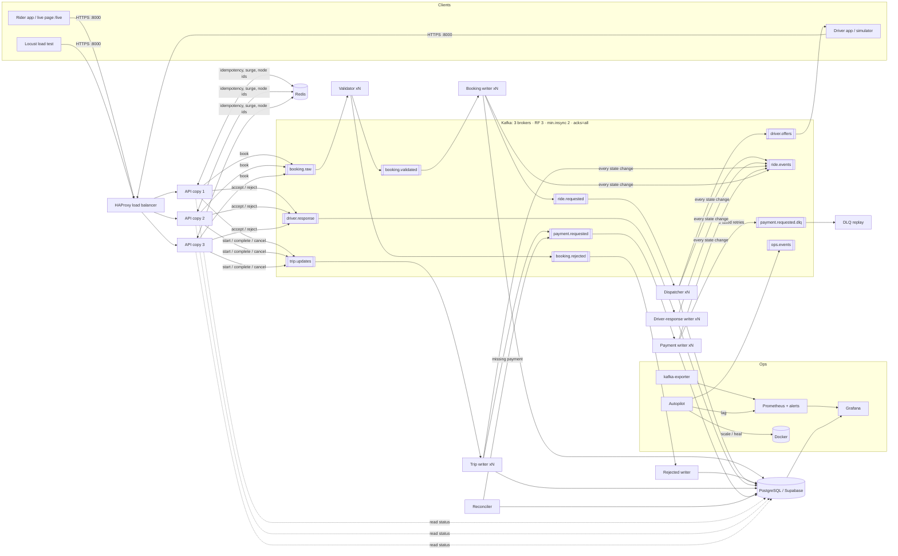

# Architecture — Ride Middleware v3

A Kafka middleware between a high-speed stream of ride requests and a relational database, built like a small Uber:
riders book, the nearest drivers get offers, drivers accept or reject, the trip runs, the rider pays. Every step is
**stored in PostgreSQL and published to Kafka**, every copy of every service can die without losing data, and an
**Autopilot** scales and heals the system on its own.

## 1. The picture



## 2. One ride, step by step

| # | What happens | Service (owner) | Stored in DB | Published to Kafka |
|---|---|---|---|---|
| 1 | Rider `POST /v1/bookings` with `Idempotency-Key`; API checks key, rate limit, prices the ride (distance × **surge**), gives a unique 53-bit `booking_id` | API (P3) | – | `booking.raw` (acks=all → 202) |
| 2 | Validator checks fields, area, fare, times, status/driver rules, **velocity guard** (≤5 bookings/min/user) | Validator (P4) | – | `booking.validated` or `booking.rejected` |
| 3a | Valid: insert booking in ONE transaction with `processed_events` (exactly-once) | Booking writer (P5) | `bookings`, `processed_events` | `ride.requested`, `ride.events REQUESTED` |
| 3b | Invalid / duplicate key: store the reason | Rejected writer (P5) | `rejected_records` | (already in `booking.rejected`) |
| 4 | Dispatcher locks the booking, ranks AVAILABLE drivers by distance, **claims 3 nearest** (`FOR UPDATE SKIP LOCKED`) | Dispatcher (P4) | `driver_responses` (OFFERED) | `driver.offers`, `ride.events OFFERED` |
| 5 | Drivers answer `POST /v1/drivers/{id}/respond` ACCEPT / REJECT | API (P3) | – | `driver.response` (key = booking_id → one partition → in order) |
| 6 | First valid ACCEPT wins: conditional UPDATE on booking **and** driver in one savepoint; others LOST; REJECT → DECLINED; never-offered driver → NOT_OFFERED | Driver-response writer (P5) | `driver_responses`, `bookings`, `drivers` | `ride.events ACCEPTED / REJECTED / ASSIGNED / LOST` |
| 7 | Nobody answers in 15 s → TIMEOUT → next 3 drivers (round 2, 3) → `NO_DRIVER` | Dispatcher sweep (P4) | `driver_responses`, `bookings` | `ride.events TIMEOUT / OFFERED / NO_DRIVER` |
| 8 | Driver `start` → `complete` (only the assigned driver, only in order); driver released at the destination | Trip writer (P5) | `bookings`, `drivers` | `ride.events STARTED / COMPLETED`, `payment.requested` |
| 9 | Payment row once per booking (`payment_id = booking_id`, `PAY-<id>` key). DB down → 3 retries → DLQ | Payment writer (P5) | `payments` | `payment.completed`, `ride.events PAID` or `payment.requested.dlq` |
| 10 | Every 30 s: COMPLETED booking without payment for >2 min → request it again (eventual consistency) | Reconciler (P6) | – | `payment.requested` |
| 11 | Rider watches it live: `GET /v1/bookings/{id}/stream` (Server-Sent Events) or `/live` page | API (P3) | reads | – |

## 3. Why nothing is lost and nothing is doubled

| Risk | Protection |
|---|---|
| A broker dies | 3 brokers, every partition on 3 brokers, `min.insync.replicas=2`, producer `acks=all` + idempotence, `unclean.leader.election=false` |
| API copy dies | 3 copies behind HAProxy (health check every 2 s, `retry-on conn-failure`, `redispatch`), Docker restarts it |
| API said 202 but Kafka didn't store it | 202 is returned **only after** Kafka confirms (acks=all). Otherwise 503 and the Idempotency-Key is freed for a retry |
| Client retries the same request | Idempotency-Key in Redis (shared by all copies) → same answer; DB `UNIQUE(idempotency_key)` is the final guard |
| Two API copies make the same booking_id | Snowflake ids: ms time + **node id leased in Redis** (one per copy) + sequence |
| Consumer crashes mid-batch | Kafka offset committed **after** the DB commit → batch re-read; `processed_events` makes the replay a no-op |
| Two drivers accept at once | `UPDATE bookings … WHERE booking_status='REQUESTED'` — exactly one row update wins (tested with 100 simultaneous races) |
| One driver wins two rides | `UPDATE drivers … WHERE availability_status='AVAILABLE'` in the same savepoint; lock order booking → driver (no deadlocks) |
| Two dispatcher copies offer the same driver | `FOR UPDATE SKIP LOCKED` on the driver row + "no open offer" check |
| DB down / slow | Writers retry the same batch with backoff 1-2-4…30 s (RETRYING logs); lag grows in Kafka, then drains |
| Payment DB keeps failing | `MAX_RETRIES=3` → `payment.requested.dlq` with error headers → `dlq-replay` after the fix |
| Booking done but payment missing (partial failure) | Reconciler re-requests it; payment insert is idempotent → exactly one payment eventually |
| Process hangs (still "running") | Heartbeat healthcheck → *unhealthy* → Autopilot restarts it |

## 4. High availability and self-healing

| Layer | Copies | If one fails |
|---|---|---|
| Load balancer | 1 (HAProxy, restart policy) | Docker restarts it in ~1 s |
| API | 3 (`deploy.replicas: 3`) + Autopilot up to 6 | HAProxy stops sending to it within 4 s; others answer |
| Kafka | 3 brokers | leaders move, writes continue with 2 in-sync copies |
| Consumers (validator, writers, dispatcher, driver, trip, payment) | 1 each + Autopilot up to 6 (= partitions) | Kafka rebalances partitions to the other copies |
| Redis | 1 | API falls back to per-copy cache + DB unique keys; surge = 1.0; velocity guard skipped (logged) |
| PostgreSQL | 1 local / Supabase managed | writers wait and retry, nothing lost (Kafka buffers) |

**Autopilot** (`services/autopilot`, the standout feature) runs every 15 s:
1. **Sense** — Prometheus: Kafka lag per consumer group, API requests/s; Docker: copies and health.
2. **Heal** — restart every container whose heartbeat healthcheck is *unhealthy* (a hung process Docker would never restart).
3. **Decide** — lag > 1,000 → add a copy (max 6 = partitions); calm for a minute → remove the extra copy (never below min, API min 3); 60 s cooldown.
4. **Act** — clone a running copy through the Docker API: same image, env, limits, security options, network alias → HAProxy, Prometheus and Kafka pick it up automatically.
5. **Tell** — `ops.events` topic + `autopilot_*` metrics → Grafana "Autopilot" row. `AUTOPILOT_DRY_RUN=true` = report only.

## 5. DevSecOps

| Area | What we do |
|---|---|
| Secrets | Only in `.env` (gitignored). `.env.example` holds placeholders. CI runs **gitleaks** on the whole history |
| Auth | `X-API-Key` per role (rider / driver / admin), constant-time compare; driver key can't book, rider key can't answer offers |
| API hardening | 10 KB body limit (413), per-client rate limit (429), strict request models (422), security headers (`nosniff`, `DENY` frames, no referrer), CSP on `/live`, no server banner |
| Containers | ONE image, **non-root** uid 10001, `read_only` filesystem + small tmpfs, `no-new-privileges`, `cap_drop: ALL`, memory + pids limits, log rotation |
| Network | Every published port bound to `127.0.0.1`; services talk on the private compose network |
| Redis | password required; volatile-lru, no persistence (only short-lived keys) |
| Database | least privilege possible (`GRAFANA_DB_USER`), `sslmode=require` for Supabase, all SQL parameterised, CHECK constraints guard statuses/fares/routes |
| Supply chain | pinned dependencies, **pip-audit**, **Dependabot** (pip, Docker, Actions), **Trivy** image scan (CRITICAL/HIGH with fix = fail) |
| Code | **ruff** (incl. security rules), **bandit** SAST, 90+ tests incl. a full end-to-end run, CODEOWNERS + PR template, branch protection on `main` |
| Delivery | GitHub Actions: lint → secret scan → tests on real PostgreSQL → compose/HAProxy validation → build → scan → push image to GHCR (main only) |

## 6. Topics

| Topic | Key | Producer → Consumer group |
|---|---|---|
| `booking.raw` | idempotency_key | API, producer → `validator` |
| `booking.validated` | idempotency_key | validator → `booking-writer` |
| `booking.rejected` | idempotency_key | validator, booking writer → `rejected-writer` |
| `ride.requested` | booking_id | booking writer → `dispatcher` |
| `driver.offers` | booking_id | dispatcher → driver apps (`driver-simulator`) |
| `driver.response` | booking_id | API → `driver-responder` |
| `trip.updates` | booking_id | API → `trip-writer` |
| `ride.events` | booking_id | everyone → audit, simulator, dashboards |
| `payment.requested` | booking_id | trip writer, booking writer, reconciler, dlq-replay → `payment-writer` |
| `payment.completed` | booking_id | payment writer → downstream |
| `payment.requested.dlq` | booking_id | payment writer → `dlq-replayer` |
| `ops.events` | service | autopilot → audit |

All: 6 partitions, replication factor 3, `min.insync.replicas=2`, 7-day retention.

## 7. Data model

Team schema (`users`, `drivers`, `vehicles`, `bookings`, `payments`) plus middleware tables — details in [DATABASE.md](DATABASE.md).

```
users 1─* bookings *─1 drivers 1─1 vehicles
             │  1                 │
             │  └─* driver_responses (OFFERED → ACCEPTED/REJECTED/TIMEOUT; ASSIGNED/LOST/DECLINED/EXPIRED/NOT_OFFERED)
             └─1 payments (payment_id = booking_id)
locations (18 areas, lat/lng)   processed_events (exactly-once)   rejected_records (why a row was refused)
```

## 8. Ports (all on your laptop only)

| URL | What |
|---|---|
| http://localhost:8000/live | live ride tracker (book + watch) |
| http://localhost:8000/docs | Swagger (all API routes) |
| http://localhost:8404/stats | HAProxy: which API copies are UP |
| http://localhost:3000 | Grafana (admin / `GRAFANA_ADMIN_PASSWORD`) |
| http://localhost:9090 | Prometheus (+ `/alerts`) |
| http://localhost:8080 | Kafka UI (topics, messages, consumer lag) |
| localhost:9092 / 9094 / 9096 | Kafka brokers |
| localhost:5432 · localhost:6379 | PostgreSQL · Redis |
